# FCM Landmark Detection

**Eksamensaflevering — EK - Erhvervsakademiet København, Machine Learning F26, maj 2026**
**Forfatter:** Andreas Søgård Gabel

---

## 1. Problemstilling

Videometer A/S anvender allerede et **eget machine-learning-system** der tager spektrale billeder af deres egen-producerede optagelsesplade, segmenterer hvert frø som en "blob" og beregner derefter center-of-mass geometrisk ud fra blob-masken. Den nuværende arbejdsgang består altså af en flerstegs-pipeline: imaging → segmentering → blob-analyse → koordinater. Resultatet leveres som en Excel-fil med felter som `Blob ID`, `X Center mass`, `Y Center mass` og `Source Image ID`.

Spørgsmålet bag dette projekt — formuleret af Videometer i deres FCM-dokument (FCM = "Frø Center of Mass") — er om en moderne **object-detection-model** kan finde frø-centre direkte i ét enkelt skridt uden at gå vejen om en separat segmentering. Hvis det er muligt, vil pipelinen blive både simplere og potentielt mere robust over for nye optagelsessituationer.

Det oprindelige forslag fra Videometer var en **Fully Convolutional Network (FCN)** der outputter et **heatmap** med frø-centre som peaks, og som evalueres mod ground truth-heatmaps via PSNR. Efter rådgivning fra underviser Jone Eikholm er der i stedet valgt en **YOLOv11n**-baseret tilgang, hvor frø-centre fås som center-of-bbox fra detektionerne. Heatmap-konceptet er bevaret som **interpretability-værktøj** i Streamlit-demoen (se sektion 5) frem for som modellens output.

Valget af YOLOv11n skyldes modellens lette form (~5 MB trænede vægte), gode anchor-fri performance på små objekter og kompatibilitet med Apple Silicon (MPS), som har været det primære udviklingsmiljø.

## 2. Datagrundlag — hvorfor syntetisk data

Adgangen til ægte Videometer-data har været begrænset gennem hele projektet: optagelserne er underlagt en NDA, mængden er lille (~13.000 blops), og manuel annotering af frø-centre er præcis det problem der ønskes løst. At basere træningen direkte på de få tilgængelige rigtige billeder ville derfor være både datafattigt og cirkulært.

I stedet er der bygget en **syntetisk data-pipeline** der procedurelt sammensætter realistiske composite-billeder: enkeltfrø-udsnit fra Videometer-optagelser placeres på et baggrundsbillede af den blå optagelses-plade, og labels genereres automatisk ud fra placeringen. Pipelinen har genereret **7.000 composite-billeder i 1280×1280** opløsning, og giver fuld kontrol over hvor mange frø der ligger i hvert billede, deres positioner og deres ikke-overlappende layout.

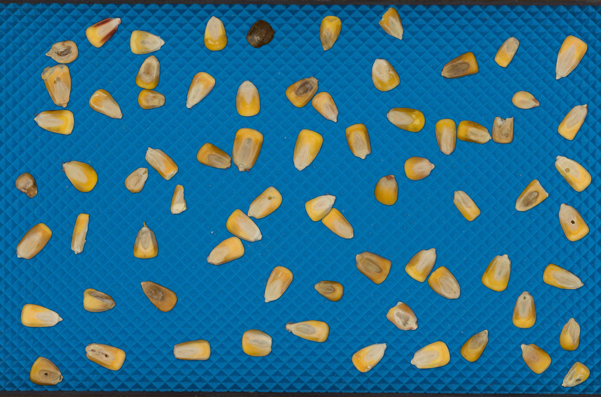
*Figur 1: Et af de 7.000 syntetiske composite-billeder brugt til træning. Frø er placeret tilfældigt på en blå plade-baggrund uden overlap.*

## 3. Tidlige tilgange og opdaget data leakage

Modellen er blevet trænet i flere iterationer hvor metodikken er strammet op undervejs:

| Version | Datasæt-tilgang | Bemærkning |
|---|---|---|
| v1_kalibreret | Kun rene frø-udsnit, ingen baggrund | Baseline — orienteringsstudie |
| v2_robust | Composite med tilfældig augmentation | Test af robusthed |
| v3_augmented | Composite med stærkere augmentation | Validerede augmenterings-strategien |
| v4_composite | Større composite-datasæt, fælles baggrunde train/val | Mistænkeligt høje metrikker |
| **v5_no_leak** | **Composite med adskilte baggrunde train/val** | **Endelig model** |

Ved gennemgang af v4-resultaterne er der opdaget en metodisk fejl: **de baggrundsbilleder der blev brugt til at konstruere composite-eksemplerne, var fælles mellem træningssæt og valideringssæt**. Hver baggrund optrådte under flere frø-konstellationer, men hvis den samme baggrund optrådte både i train og val, kunne modellen lære features ved baggrunden selv frem for ved frøene. Det er klassisk data leakage og forklarer hvorfor v4-metrikker var urealistisk gode.

Læringen har formet hele den endelige pipeline: **enhver baggrund må kun optræde i ét split**. Den re-arkitekterede composite-generator splitter først baggrunds-poolen i train/val/test, og bygger derefter composite-billeder inden for hvert split. Det er denne disciplin der gør v5's tal troværdige.

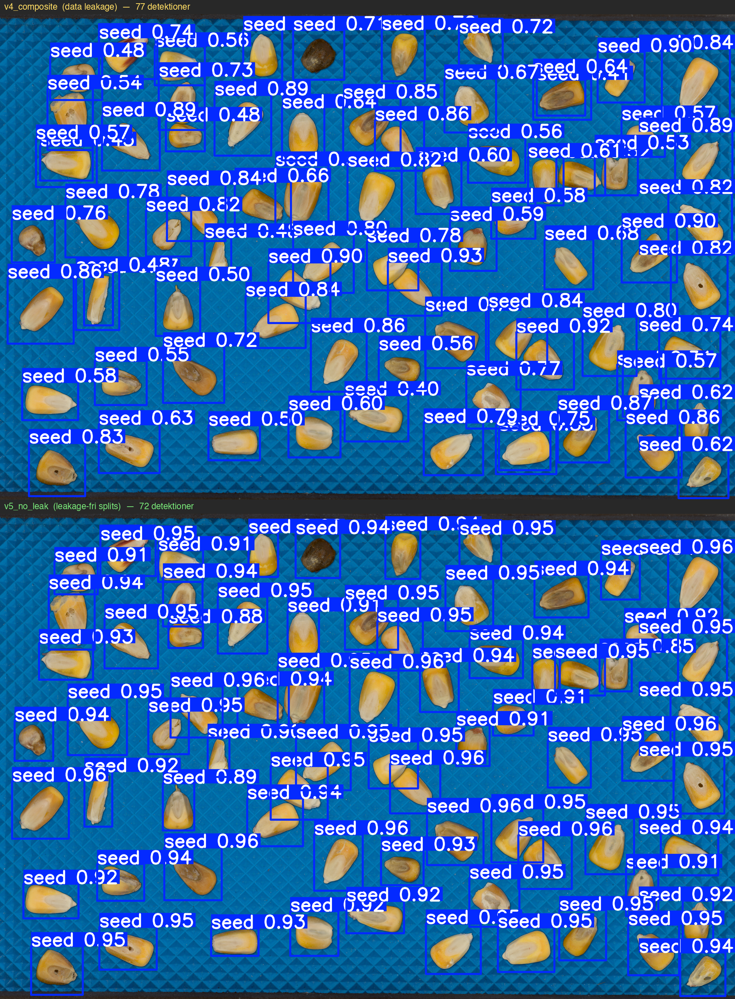
*Figur 2: Side-by-side sammenligning af v4_composite og v5_no_leak på samme testbillede. v4 (øverst) viser markant lavere og mere spredte confidence-scores (0.40-0.92), mens v5 (nederst) har stabile høje scores (0.91-0.96). Forskellen illustrerer hvordan data leakage skævvred v4's interne sikkerhed.*

## 4. Composite-pipelinen og v5_no_leak

Den endelige pipeline består af **seks moduler** der hver har ét ansvar:

1. **Baggrunds-loader** — indlæser plade-baggrunde og splitter dem i train/val/test (baggrundene blandes aldrig på tværs af splits).
2. **Frø-katalog** — holder en pulje af enkeltfrø-udsnit med metadata om størrelse og center-masse.
3. **Layout-generator** — placerer N frø tilfældigt på en baggrund uden overlap.
4. **Composite-renderer** — sammensætter baggrund + frø til ét billede og holder styr på pixel-koordinater.
5. **Label-skriver** — skriver YOLO-formatterede labels (klasse + normaliserede bbox-koordinater) per billede.
6. **Manifest-bygger** — gemmer `data.yaml` og generation-metadata så datasættet er fuldt sporbart.

Træningen af v5_no_leak er gennemført på en Mac M-chip vha. PyTorch's MPS-backend over **80 epochs** med YOLOv11n som startpunkt. Træningskonfiguration: input-størrelse 1280×1280, batch 4, patience 15, learning rate auto-tuned. Datasættet er splittet i **1600 train / 400 val** med leakage-frie baggrunde mellem splits.

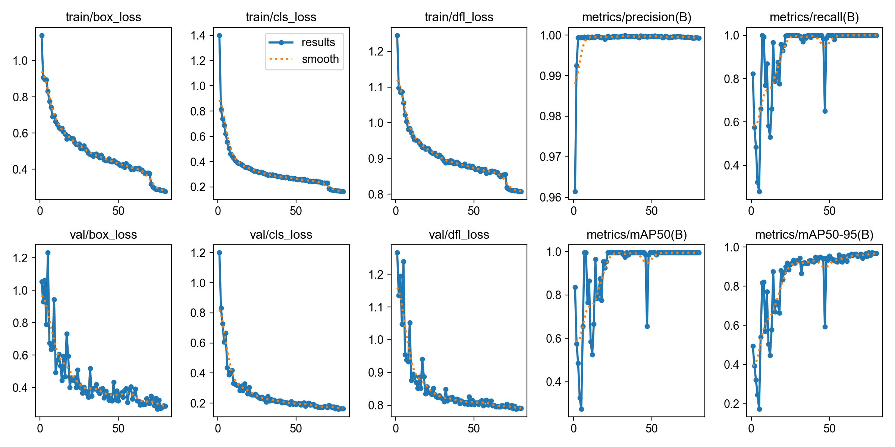
*Figur 3: Train- og val-loss + metrikker over 80 epochs. mAP@50 konvergerer hurtigt, mens mAP@50-95 fortsætter med at stige langsomt.*

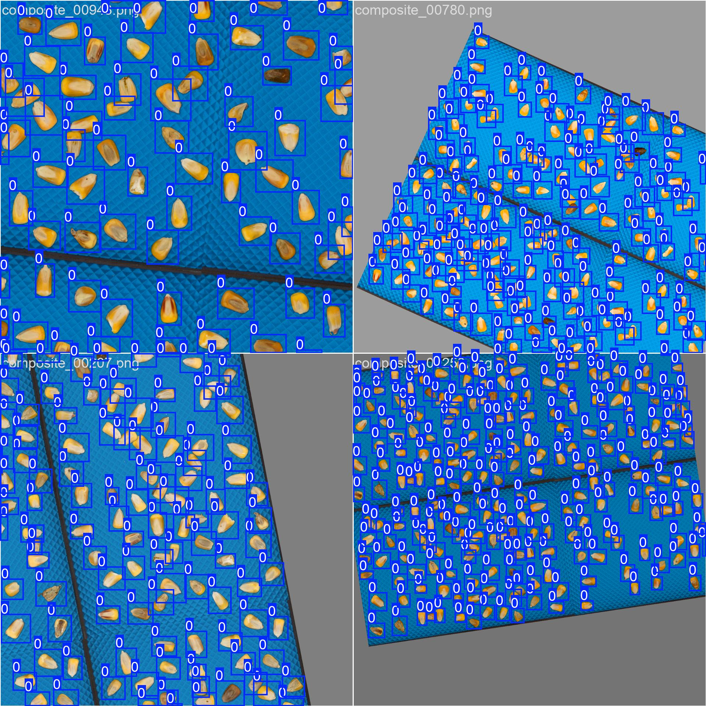
*Figur 4: Et træningsbatch som det reelt blev set af modellen — Ultralytics' indbyggede augmentation (mosaic, scaling, color jitter) er anvendt løbende for at gøre modellen robust over for varierende sammensætninger af frø.*

## 5. Resultater

På valideringssættet — som ingen baggrunde deler med træningssættet — har v5_no_leak opnået følgende slutmetrikker:

| Metric | Værdi |
|---|---|
| Precision | 0.999 |
| Recall | 1.000 |
| mAP@50 | **0.999** |
| mAP@50-95 | **0.969** |

Tallene er konsistente med kvaliteten af de syntetiske data og indikerer at modellen har lært at lokalisere frø meget pålideligt på composite-billeder. Det skal understreges at evalueringen stadig foregår på syntetisk data — den endelige validering på rigtige Videometer-billeder er planlagt men ligger uden for denne aflevering.

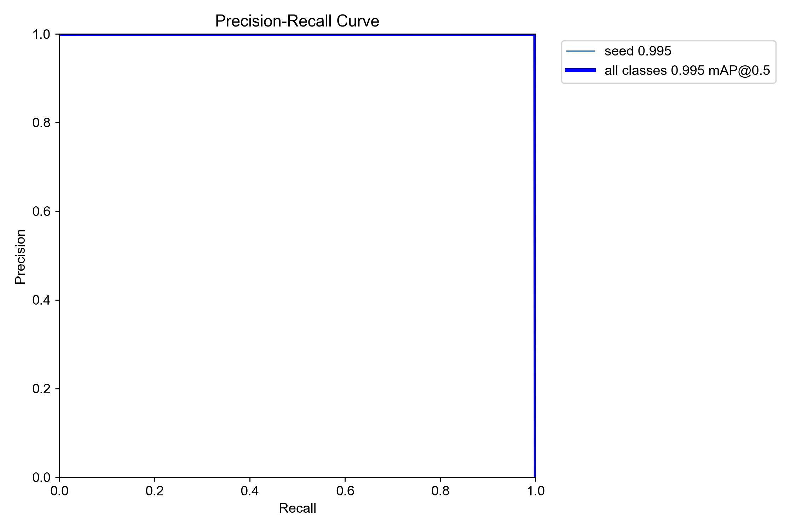
*Figur 5: Precision-Recall-kurven viser at modellen holder >0.99 precision over hele recall-spektret.*

### Objectness heatmap som interpretability

Som interpretability-værktøj er der i Streamlit-demoen indbygget en visualisering af modellens **interne objectness-confidence** før NMS og bbox-decoding. Heatmap'et opsamles ved at hooke ind på YOLO-modellens Detect-lag og summere klassesandsynligheder per grid-celle på tværs af de tre featuremap-skalaer (P3, P4, P5).

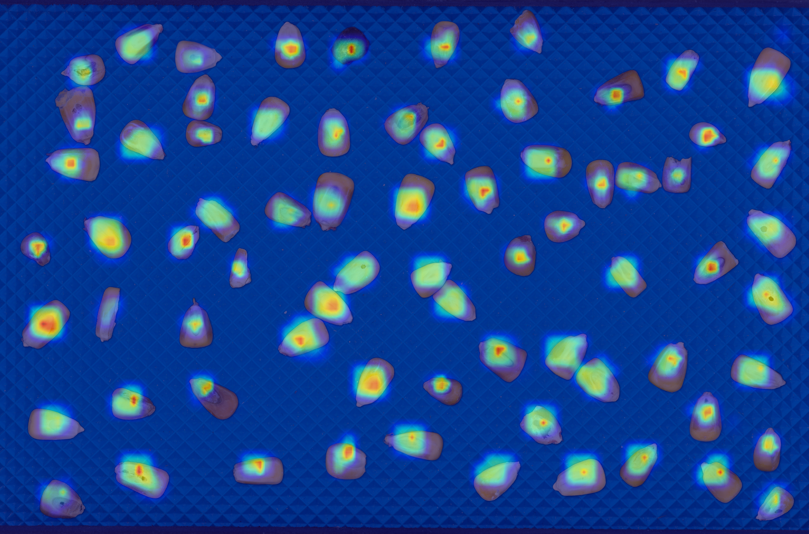
*Figur 6: Objectness heatmap (blå=lav, rød=høj) lagt oven på et testbillede. Modellens interne confidence "tænder" netop der hvor de detekterede bounding boxes ligger — visuelt bekræft af at modellen ikke "snyder" via baggrundens features.*

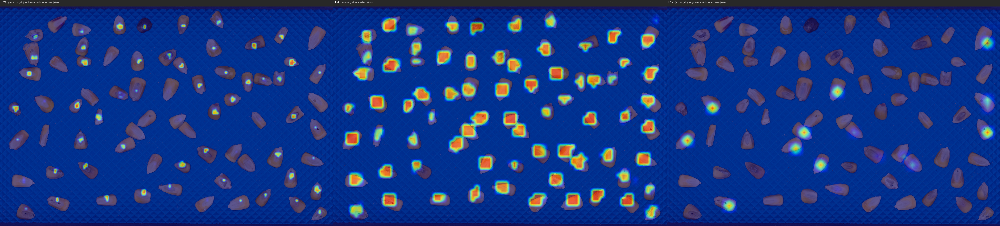
*Figur 7: Heatmap'et split op pr. featuremap-skala (P3, P4, P5). YOLOv11n laver detektioner på tre opløsninger samtidig. P4 (midterst, 80×54 grid) bærer det meste af signalet for frø af denne størrelse, mens P3 og P5 fanger henholdsvis mindre detaljer og bredere kontekst.*

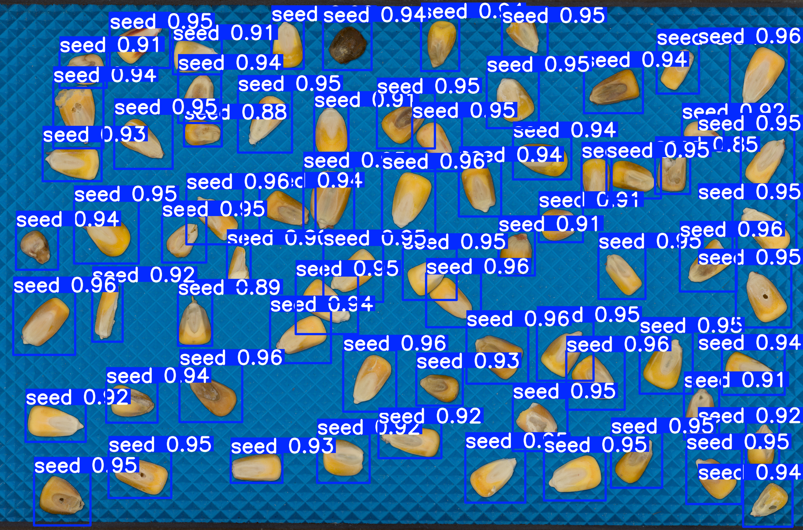
*Figur 8: Predictions fra v5_no_leak på composite_00000.png. Hver bounding box svarer til et detekteret frø.*

### Streamlit-demo

Hele modellen er pakket ind i en Streamlit-app der lader brugeren uploade et billede og inspicere både predictions, metadata og confidence-fordeling interaktivt. Demoen er det primære værktøj til at vise modellen frem under den mundtlige eksamen.

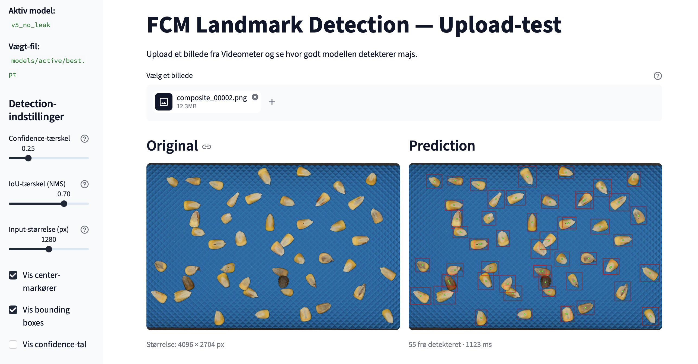
*Figur 9: Streamlit-demo'en. Sidebar tillader justering af confidence-tærskel, IoU-tærskel og input-størrelse. Hovedvinduet viser original + prediction side-by-side; nedenunder følger metadata-blok og confidence-statistik (ikke vist her).*

## 6. Refleksion og fremtidsudsigter

**Real-world validering** er det vigtigste næste skridt. Resultaterne ovenfor er imponerende på syntetisk data, men gabet mellem syntetisk og rigtigt er kendt fra litteraturen. Et besøg hos Videometer er aftalt med henblik på at køre v5_no_leak på en lille mængde ægte plade-optagelser og rapportere mAP samt fejl i mm via den kalibrerede mm/pixel-faktor.

**Mulige forbedringer** identificeret under arbejdet:

- **Mere realistisk lyssætning** i composite-generatoren — den nuværende blå plade har konstant belysning, mens rigtige Videometer-optagelser har subtile lys-gradienter.
- **Multi-class detection** — modellen detekterer kun "frø". Hvis flere kornsorter skal skelnes, skal pipelinen udvides med klasse-balancerede syntetiske eksempler.
- **Domain adaptation** — selv en mindre fine-tuning på ægte data forventes at forbedre generaliseringen betydeligt.

**Metodisk refleksion.** Den vigtigste læring fra projektet er ikke selve modellens arkitektur, men opdagelsen af data leakage mellem v4 og v5. Det demonstrerer hvor let det er at producere imponerende tal på en utæt evaluering, og hvor vigtigt det er at splitte ikke kun *eksemplerne* men også *de underliggende kilder* (her: baggrunds-billederne) når et syntetisk datasæt bygges fra et lille sæt råmaterialer.

I forlængelse af denne refleksion er der gjort en bevidst indsats for at gøre modellens egenskaber **gennemsigtige** i demoen. Både den fulde træningskonfiguration og en confidence-fordeling pr. inference er eksponeret direkte, så modellen kan vurderes på andet end et enkelt mAP-tal.

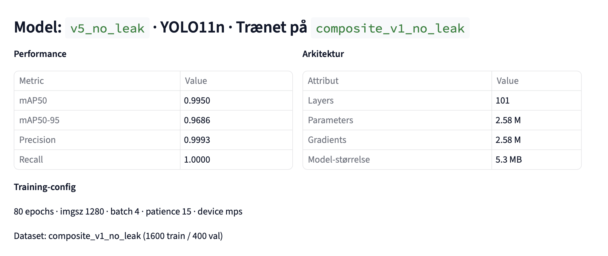
*Figur 10: Model-metadata vist direkte i demoen. Hele træningskonfigurationen — arkitektur, parametre, dataset-split, epochs, batch, patience — er tilgængelig sammen med performance-tallene, så ingen del af resultatet er skjult.*

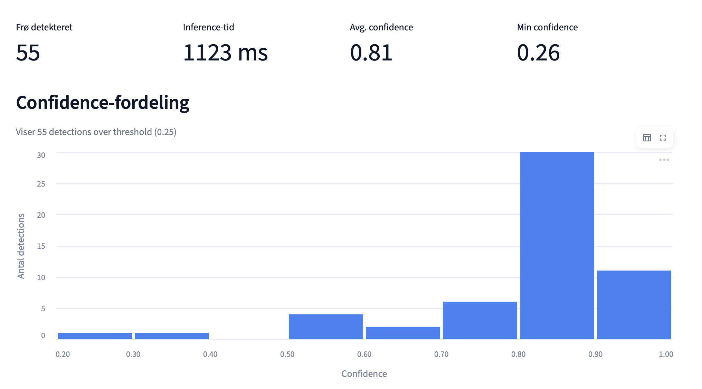
*Figur 11: Confidence-fordelingen for predictions på et testbillede (composite_00002.png). Histogrammet anvendes til hurtigt at vurdere om modellen er stabilt sikker (peak omkring 0.8-0.9), eller om mange detektioner ligger nær threshold og bør gennemses manuelt.*

---

*Repo: <github-link kommer her>. Demo: `streamlit run scripts/03_demo/upload_demo.py`. Reproducer rapport-billeder: `python scripts/05_generate_report_assets.py`.*
